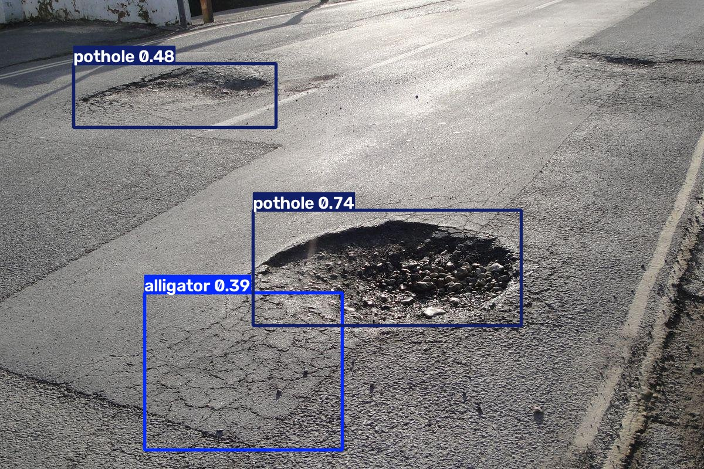
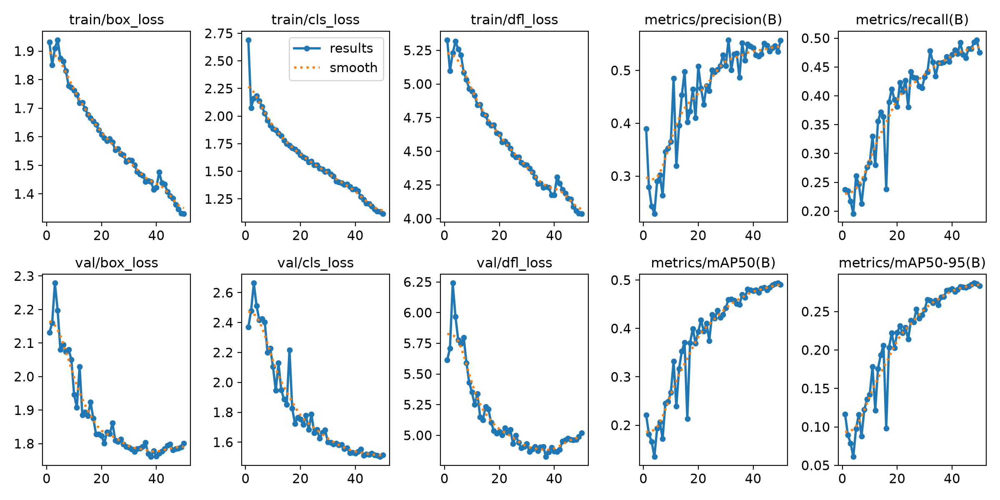
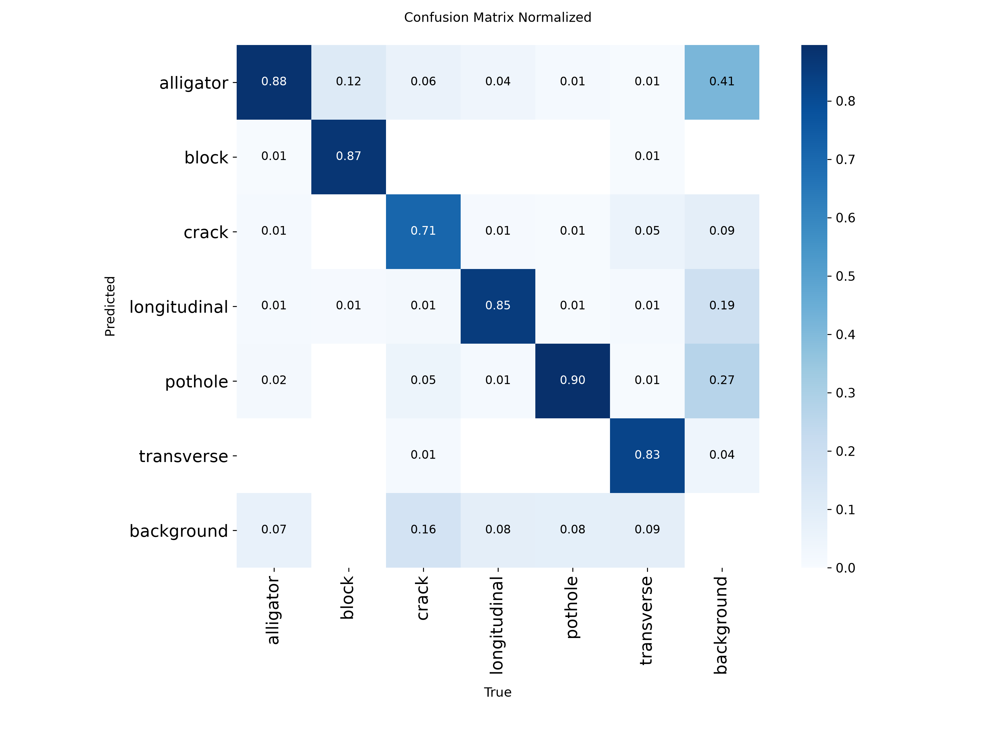
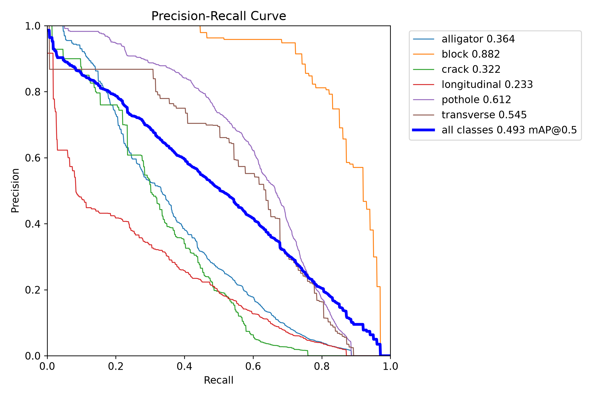

# Road Damage Detection with YOLO (v8 vs v10 vs 11)

An end-to-end object detection project. It trains and compares three YOLO versions for detecting 6 types of road damage, tunes their hyperparameters, evaluates them on a held-out test set (accuracy, IoU, speed, size, ONNX deployment), and serves the best model in a FastAPI web app with image upload and live webcam detection.



Built as Sprint 2 (Deep Learning & Computer Vision) of the Instant Software Solutions AI & Data Analysis training.

---

## Dataset
- [road-damage](https://universe.roboflow.com/trafficsignssafeway/road-damage-l1ju7) on Roboflow Universe (CC BY 4.0). It has 6,757 images, split 70 / 20 / 10 into train / valid / test.
- The original data has 7 classes. `edge` was dropped because it had only 22 boxes and none in the test set, so it could be neither learned nor evaluated.
- Final classes: `alligator`, `block`, `crack`, `longitudinal`, `pothole`, `transverse`.
- The data is imbalanced: pothole (42%) and alligator (29%) dominate, while block (2%) and transverse (3%) are rare.

## Method
| Step | Script | What it does |
|---|---|---|
| 1 | `src/01_dataset_check.py` | Counts images and boxes per class and split; finds missing or empty labels |
| 2 | `src/02_prepare_6classes.py` | Removes `edge`, renumbers the classes, writes the 6-class `data.yaml` |
| 3 | `src/03_train_baseline.py` | Trains YOLOv8s, YOLOv10s and YOLO11s with identical settings (COCO-pretrained, 50 epochs, patience 15, 640 px, batch 16, seed 0) |
| 4 | `src/04_tune.py` | Genetic hyperparameter search (`model.tune`), then a full 50-epoch retrain with the winning settings |
| 5 | `src/05_evaluate.py` | Test-set mAP, precision/recall, IoU, GPU/CPU FPS, model size, ONNX export and CPU speed; picks the best model for the app |
| 6 | `app/app.py` | FastAPI app: upload page, live webcam mode and a `/detect` JSON API |

Hardware: one NVIDIA RTX 3060 Ti (8 GB).

## Results on the test set (676 unseen images)

| Model | Precision | Recall | mAP50 | mAP50-95 | IoU* | GPU FPS | CPU FPS | ONNX CPU FPS | Size (.pt) | Params |
|---|---|---|---|---|---|---|---|---|---|---|
| YOLOv8s | 0.604 | 0.577 | 0.592 | 0.362 | 0.766 | 78.0 | 12.1 | 9.8 | 22.5 MB | 11.1 M |
| YOLOv8s (tuned) | 0.602 | 0.583 | 0.592 | 0.370 | 0.769 | 79.7 | 12.1 | 10.2 | 22.5 MB | 11.1 M |
| YOLOv10s | 0.618 | 0.569 | 0.604 | 0.371 | 0.774 | 86.8 | 13.8 | 11.9 | 16.5 MB | 8.1 M |
| YOLO11s | 0.640 | 0.562 | 0.604 | 0.372 | 0.776 | 78.9 | 13.6 | 12.0 | 19.2 MB | 9.4 M |
| YOLO11s (tuned) | 0.607 | 0.560 | 0.595 | 0.377 | 0.777 | 83.7 | 13.5 | 12.5 | 19.2 MB | 9.4 M |

\*IoU is the mean overlap between each correctly detected box (same class, IoU of at least 0.5) and its ground-truth box. FPS counts the whole pipeline (pre-processing, model and post-processing) at batch size 1. Full numbers are in [`results/`](results/).

Per-class AP50 on the test set (YOLO11s tuned): alligator 0.34, block 0.86, crack 0.84, longitudinal 0.27, pothole 0.67, transverse 0.59

| Training curves | Confusion matrix | PR curve |
|---|---|---|
|  |  |  |

## Key findings
- Accuracy is a near-tie. All models land within about 1.5 mAP points of each other on the test set, which is within run-to-run noise.
- YOLOv10s is the most efficient. It has the fewest parameters, the smallest files and the fastest GPU and CPU inference, plus the best mAP50. That suits real-time or edge use.
- YOLO11s (tuned) has the best mAP50-95, meaning the tightest boxes. It is the model the app uses.
- Hyperparameter tuning gave no meaningful gain. The defaults won the search for YOLOv8s and YOLOv10s, and the small YOLO11s gain did not hold up clearly. Ultralytics' defaults were already near-optimal for this compute budget.
- The hardest classes are alligator and longitudinal cracks. Their texture-like or long, thin shapes give ambiguous box boundaries.
- ONNX on CPU was slightly slower than PyTorch on this machine. The ONNX export is FP32, and its benefit is portability: it runs without PyTorch installed.

## Quick start

```bash
git clone https://github.com/7zumax/road-damage-yolo.git
cd road-damage-yolo
pip install torch torchvision --index-url https://download.pytorch.org/whl/cu124   # GPU build
pip install -r requirements.txt
```

Run the app. The trained model `app/best.pt` is included.
```bash
cd app
uvicorn app:app --host 127.0.0.1 --port 8000
# open http://127.0.0.1:8000   (on Windows you can just double-click app/run_app.bat)
```

API example:
```bash
curl -F "file=@road.jpg" -F "conf=0.25" http://127.0.0.1:8000/detect
```
```json
{"model": "tuned_yolo11s", "inference_ms": 64.8, "count": 3,
 "counts": {"pothole": 2, "alligator": 1},
 "detections": [{"class": "pothole", "confidence": 0.742, "box": [431.4, 358.0, 888.3, 555.9]}, "..."],
 "image": "data:image/jpeg;base64,..."}
```

Reproduce the experiments. First download the data, following [`data/README.md`](data/README.md). Then run:
```bash
cd src
python 01_dataset_check.py
python 02_prepare_6classes.py
python 03_train_baseline.py      # ~2 h on an RTX 3060 Ti
python 04_tune.py                # ~1.5 h (4 trials x 6 epochs per model + retrains)
python 05_evaluate.py            # ~10 min
```

## Project structure
| Path | What it is |
|---|---|
| `app/app.py` | FastAPI app (upload page, webcam and `/detect` API) |
| `app/best.pt` | deployed model (YOLO11s, tuned) |
| `app/run_app.bat` | starts the app on Windows |
| `app/test_app.py` | tests the app endpoints |
| `data/README.md` | how to download the dataset |
| `results/` | CSV results and figures |
| `src/` | steps 1 to 5 |

## Tech stack
Python, PyTorch, Ultralytics YOLO (v8, v10, 11), ONNX Runtime, OpenCV, FastAPI, Uvicorn, Roboflow
